# Display layout

`display layout` renders a JSON spec into a 16:9 page. These pictures are headless renders at 1920×1080. They do not use a physical display.

## Command flow

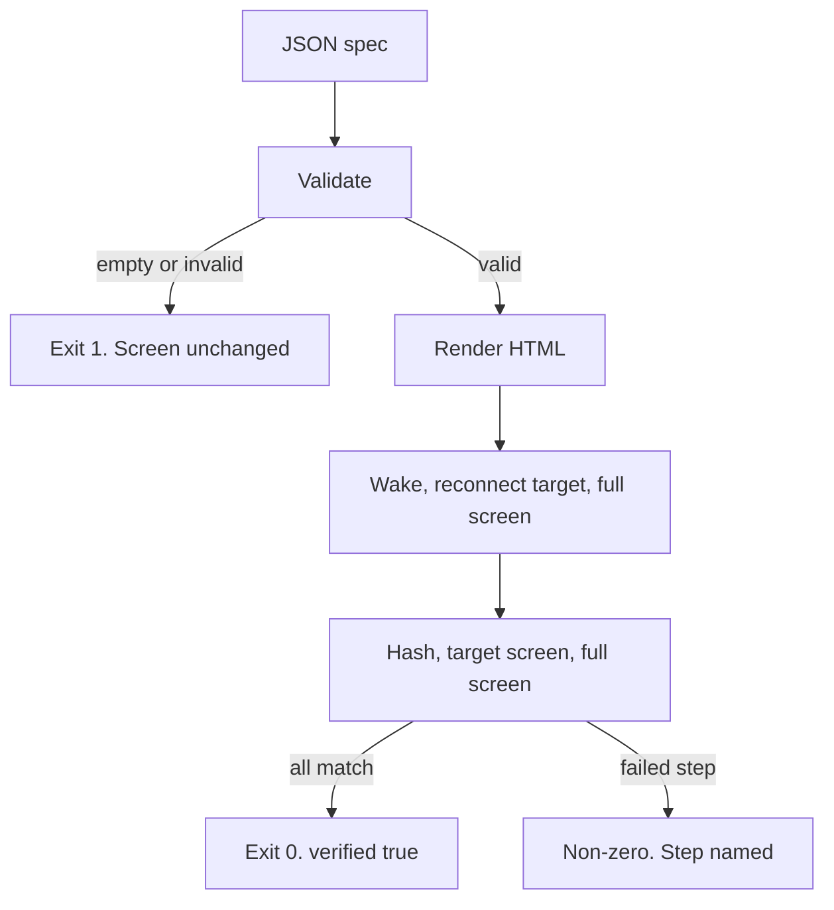

An empty file, invalid JSON, unknown theme, unknown module, or blank field stops at validate. The current page stays in place.

## Token scale

Type sizes are vh. Steps from `xs` through `l` are 1.5 times the previous step. `xl` is 8vh. `xxl` is 12vh, 1.5 times `xl`.

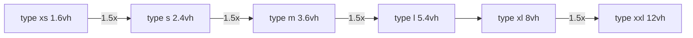

Space tokens. `l` is the grid gap. `xl` is the page margin.

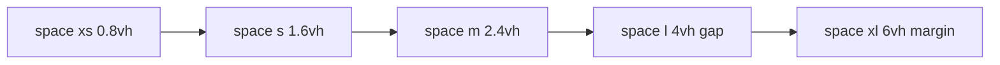

CSS names are `--type-xs` through `--type-xxl` and `--space-xs` through `--space-xl`.

## Module catalog

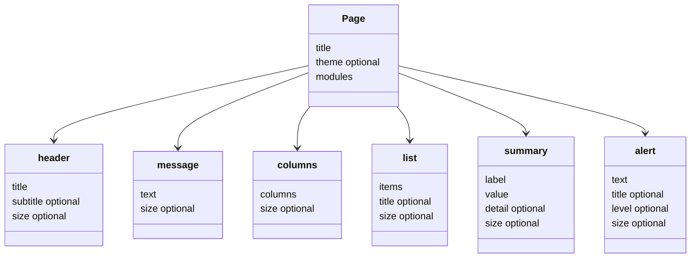

A column has an optional `title` and `items`. A list or column item is `{ "leading", "text" }` or a string used as `text`. Alert `level` is `info`, `warning`, or `critical`. `size` is a type token.

## Themes

The same reminder on `default` and `moonlit-autumn`.

| Default | Moonlit autumn |
| --- | --- |
|  |  |

The same schedule on both themes.

| Default | Moonlit autumn |
| --- | --- |
| 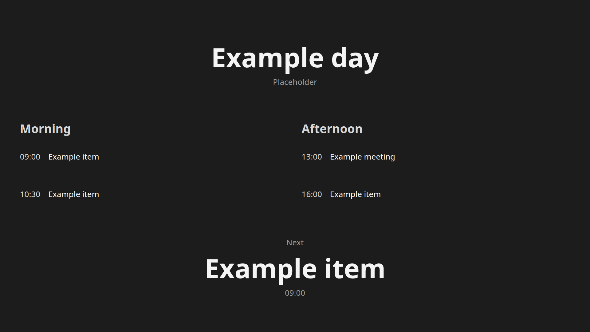 | 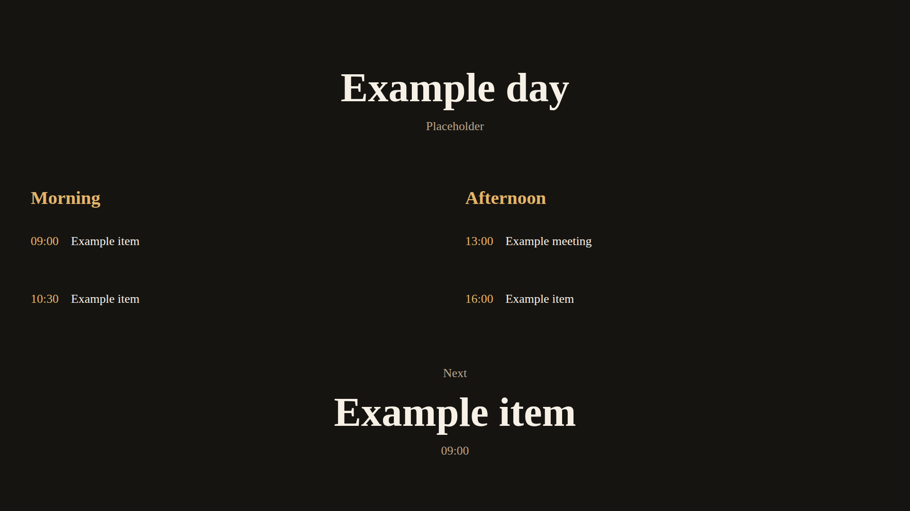 |

## Pages

One-line reminder. One message block fills the canvas.

Multi-section schedule. Header, two columns, and a summary share the page.

Alert. A warning and a critical alert each take a slot under a header.

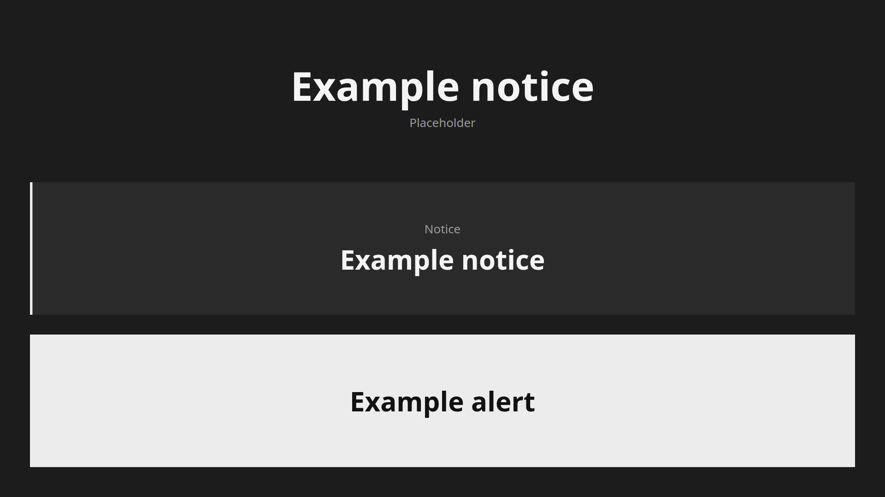

List and summary.

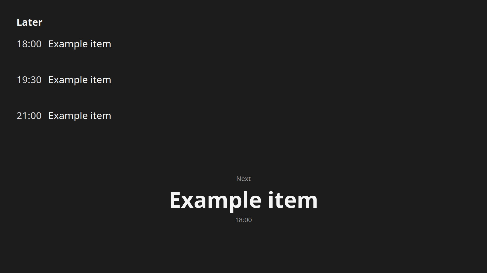

## Blocks fill the grid

Each block is `flex: 1`. Rows use `grid-auto-rows: minmax(0, 1fr)` and `gap: var(--space-l)`. Adding a block shortens the others. Nothing is left over.

| 1 block | 2 blocks |
| --- | --- |
|  | 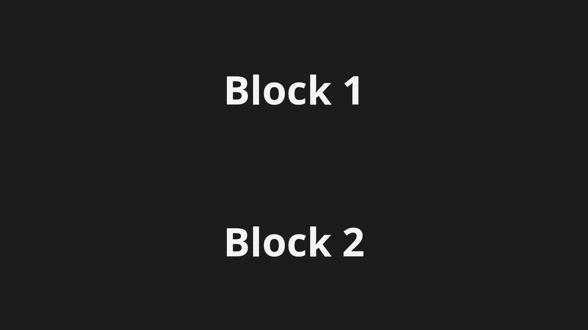 |

| 3 blocks | 4 blocks |
| --- | --- |
| 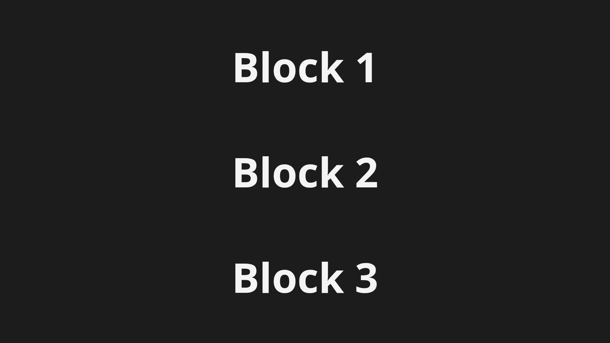 | 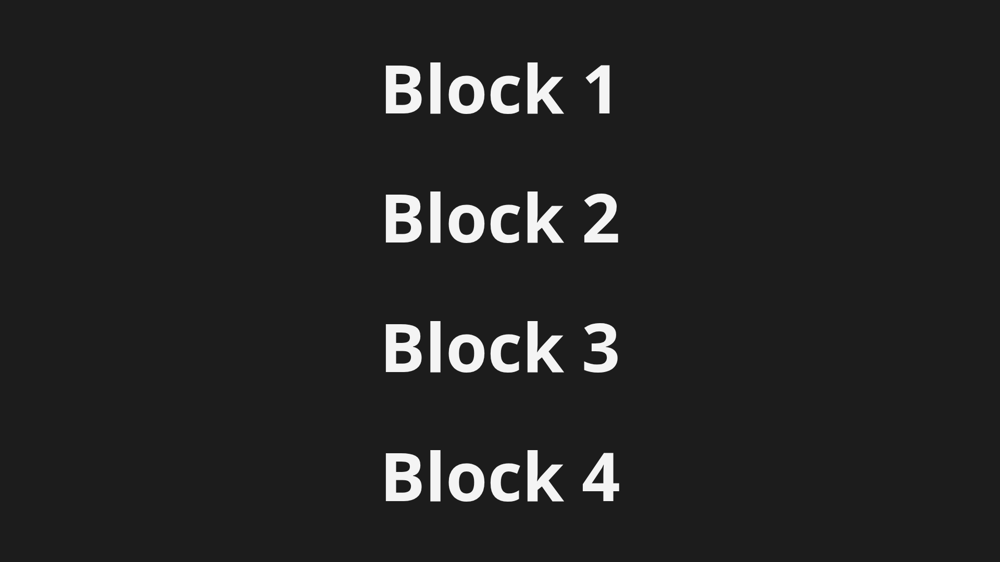 |

## Grid overlay

The red band is the page margin, `space-xl` (6vh). The amber bands are the grid gaps, `space-l` (4vh). The blue outlines are the slots.

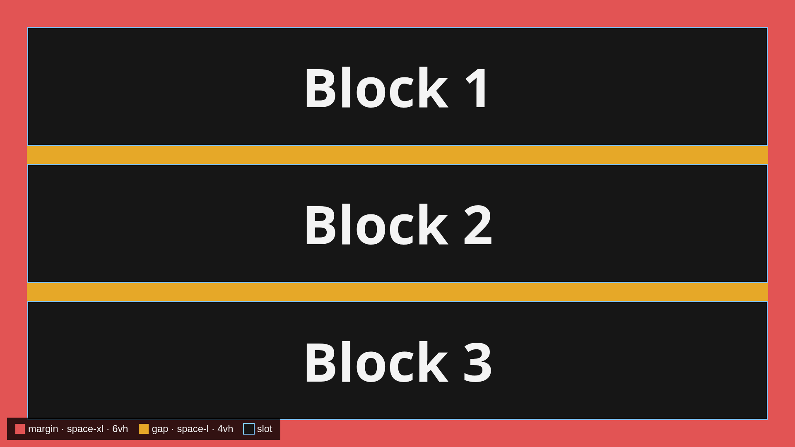
